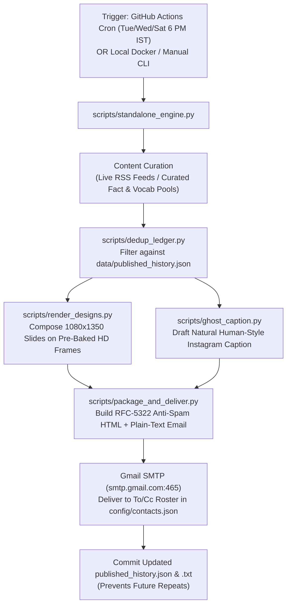

# SOLE — Bits & Bytes Social Media Automation Documentation

Complete technical and operational documentation for the **SOLE (Society Of Literary Enthusiasts) — Bits & Bytes** social media automation system at **IGIT Sarang (Indira Gandhi Institute of Technology, Sarang)**.

---

## 1. Project Overview & Goals

This system automates the weekly research, deduplication, carousel design rendering, caption drafting, and email packaging for **Bits & Bytes** social media posts on Instagram (`@sole_igit`).

### Core Principles
- **Zero Subscriptions ($0/month):** Runs entirely on free, open-source tooling (Python, Pillow, Docker, n8n, GitHub Actions, and Gmail SMTP with an App Password). No paid Zapier, Canva Pro, or third-party SaaS APIs.
- **Standalone & Offline-Capable:** Completely independent of Antigravity. Runs automatically in the cloud via **GitHub Actions** even when the maintainer's laptop is powered off, and also runs locally via **Docker Compose**.
- **Human-in-the-Loop Delivery (No Auto-Posting):** The automation never auto-posts to Instagram. Instead, it emails the ready-to-post 1080×1350 carousel designs (PDF + slides), Instagram caption, and content brief to the Design & Social Media leads one day ahead of posting so the team can either publish the generated design directly or adapt it.
- **Instagram-Only:** SOLE does not have a LinkedIn page, so all captions and packaging target Instagram (`@sole_igit`) exclusively.

---

## 2. Weekly Schedule (`Asia/Kolkata`)

All scheduled runs execute at **6:00 PM IST (`12:30 UTC`)** the evening before the target Instagram post day:

| Content Type | Mail Day & Time (IST) | Target Post Day | Carousel Length | Description |
| :--- | :--- | :--- | :--- | :--- |
| **Random Fact of the Week** | **Tuesday, 6:00 PM** | Wednesday | 4 slides (1080×1350) | Hook cover, the surprising fact, the mechanism/why it happens, and interactive CTA |
| **Random Vocabulary / Thesaurus** | **Wednesday, 6:00 PM** | Thursday | 4 slides (1080×1350) | Curiosity hook cover, word + pronunciation + meaning, synonyms/antonyms/usage, and challenge CTA |
| **Weekly News Highlights** | **Saturday, 6:00 PM** | Sunday | 8 slides (1080×1350) | Cover, 6 curated tech/science/world highlights (plus full Top 10 table with sources in email), and CTA |

---

## 3. System Architecture



### Dual Execution Environments
1. **Offline Cloud Runner (Primary):** [`.github/workflows/bits-bytes-offline-cron.yml`](.github/workflows/bits-bytes-offline-cron.yml) runs on `ubuntu-latest` via GitHub Actions cron (`30 12 * * 2,3,6` UTC). It installs Montserrat/Caladea/Liberation Serif fonts, runs `scripts/standalone_engine.py --type auto --send-mail`, uploads the generated `output/` folder as a workflow artifact, and commits updated deduplication history back to `main` with `[skip ci]`. Supports manual triggers via `workflow_dispatch` (`auto`, `news`, `facts`, `vocab`).
2. **Local Docker Stack (Optional / Local UI):** [`docker-compose.yml`](docker-compose.yml) + [`Dockerfile`](Dockerfile) run two persistent (`restart: unless-stopped`) services:
   - `bits-bytes-engine` (`127.0.0.1:8765`) — Python automation engine with local Ollama fallback (`gemma4:e2b`).
   - `bits-bytes-n8n` (`127.0.0.1:5678`) — Local n8n instance wired to `http://bits-bytes-engine:8765` and mounted to `./data` and `./output`.

---

## 4. Repository Structure

| Path | Purpose |
| :--- | :--- |
| `config/contacts.json` | Organization metadata, sender info, weekly schedule, and active `To` / `Cc` recipient roster. |
| `assets/bits_n_bytes_template.jpg` | Official SOLE `BITS -N- BYTES` reference poster provided by the team. |
| `assets/sole_logo_hd.png` | High-resolution transparent SOLE logo (270×259 RGBA). |
| `assets/igit_logo_hd.png` | High-resolution transparent IGIT Sarang logo (309×309 RGBA). |
| `assets/base_cover_frame.png` | Pre-baked 1080×1350 cover canvas (cosmic background, exact torn graph-paper corners, HD header logos, footer handle). |
| `assets/base_inner_frame.png` | Pre-baked 1080×1350 inner slide canvas (reused across every slide to minimize compute). |
| `scripts/build_static_assets.py` | One-time / on-demand builder that extracts transparent HD logos and bakes `base_cover_frame.png` & `base_inner_frame.png`. |
| `scripts/standalone_engine.py` | Main entrypoint orchestrating curation, deduplication, rendering, captioning, email delivery, and history updates. |
| `scripts/render_designs.py` | Pillow-based 1080×1350 carousel renderer (4:4:4 JPEGs + multi-page PDF + Canva CSV + Google Slides JSON). |
| `scripts/ghost_caption.py` | Caption generator & sanitizer that removes AI clichés, em/en dashes, and robotic phrasing. |
| `scripts/dedup_ledger.py` | Manages `data/published_history.json` and `data/published_history.txt` to prevent duplicate topics. |
| `scripts/package_and_deliver.py` | Builds RFC-5322 compliant HTML + plain-text emails with inline CID HD logos and sends via Gmail SMTP. |
| `data/published_history.json` | Machine-readable deduplication ledger of all previously sent News, Facts, and Vocabulary entries. |
| `data/published_history.txt` | Human-readable mirror of published history. |
| `.github/workflows/bits-bytes-offline-cron.yml` | Zero-cost GitHub Actions cron workflow for offline execution. |
| `Dockerfile` & `docker-compose.yml` | Local containerized runtime for `bits-bytes-engine` and `bits-bytes-n8n`. |
| `peer_review_samples/` | Peer-approved sample carousels and briefs for News, Facts, and Vocabulary. |

---

## 5. Visual Design System & Pre-Baked Asset Pipeline

The visual design went through multiple iterations and peer review to optimize for short attention spans, mobile readability, and brand fidelity:

### Design Standards (Peer-Approved)
- **Canvas Size:** `1080 × 1350 px` (4:5 Instagram portrait carousel).
- **Exact Brand Edges:** Preserves the exact torn graph-paper corner overlays from the official `BITS -N- BYTES` template (`assets/bits_n_bytes_template.jpg`).
- **100% Horizontally Centered Layout:** All content boxes are centered on `x = 540px` (`COL_X1 = 165`, `COL_X2 = 915`, width `750px`) for clean visual balance.
- **Zero Overlapping or Clipping:** Uses `draw_fitted_text_block()` to dynamically measure, wrap, and scale typography so no text ever overflows its card or collides with adjacent elements.
- **Attention-Retention & Curiosity Hooks:** Cover slides use curiosity-gap headlines and directional scroll cues to encourage swiping through to the final slide.
- **Editorial Rules Enforced:**
  - Always displays a prominent **Week Edition badge** (e.g., `NOV 2026 • WEEK 3`).
  - Uses **`WEEKLY NEWS HIGHLIGHTS`** branding (never `"Top 10 Countdown"`).
  - **No** slide/page number markers (e.g., no `01/08`).
  - **No** relevance/popularity scores or source URLs cluttering the graphic cards (sources are placed cleanly in the email HTML table instead).

### HD Logo Extraction & Static Frame Caching
- **Background Removal Without Interior Loss:** Raw logos were processed via exterior-only BFS flood-fill + anti-aliased edge de-fringing so 100% of interior white details (such as the gear teeth, book pages, and lettering inside the IGIT emblem and SOLE icon) remain intact.
- **Compute Optimization:** Repeated background elements (cosmic backdrop, torn graph-paper corners, HD header bar, and `@sole_igit` footer) are pre-baked once into `assets/base_cover_frame.png` (704 KB) and `assets/base_inner_frame.png` (417 KB) via `scripts/build_static_assets.py`. This reduces per-carousel rendering time to **~1.3s–2.5s**.
- **Cross-Platform Path & Font Portability:** All scripts resolve paths dynamically via `BASE_DIR = Path(__file__).resolve().parent.parent` and discover fonts via `rglob` so they run identically on Fedora/local Linux, Docker, and GitHub Actions `ubuntu-latest`.
- **Lightweight Sharp Exports:** Slides are saved as 4:4:4 JPEGs (`quality=92, subsampling=0`) alongside a combined `carousel_slides.pdf` to keep email attachments sharp yet fast to upload over SMTP.

---

## 6. Content Curation, Deduplication & Captioning

### Deduplication Ledger (`scripts/dedup_ledger.py`)
- Every published News headline, Random Fact, and Vocabulary word is recorded in `data/published_history.json` (and mirrored to `data/published_history.txt`).
- Before rendering, candidate items are checked against the ledger so previously sent topics (such as earlier sample items `Vellichor`, `Ada Lovelace`, `Perspicacious`, and prior news stories) are never repeated.
- In GitHub Actions, the updated ledger is automatically committed back to `main` after each successful email delivery.

### Caption Style (`scripts/ghost_caption.py`)
- Generates concise, conversational Instagram captions for `@sole_igit`.
- Enforces plain-writing sanitization internally: strips em/en dashes (`—`, `–`), removes cliché AI buzzwords, and keeps hooks punchy for Instagram readers.
- Internal sanitization/tooling labels are never mentioned in the outgoing email.

---

## 7. Email Delivery, Anti-Spam Hardening & Recipients

### Anti-Spam & Reliability Engineering (`scripts/package_and_deliver.py`)
Emails are constructed to land cleanly in Gmail's Primary inbox rather than Spam:
- **Full RFC-5322 Headers:** Explicit `Date`, `Message-ID` (domain-qualified), `From`, `To`, `Cc`, and `Reply-To`.
- **Clean Multipart Structure:** `multipart/mixed` wrapping `multipart/alternative` (`text/plain` fallback + `multipart/related` containing clean white-background `text/html` and inline CID HD logos `igit_logo` & `sole_logo`).
- **No Spammy Marketing Styling:** Uses a crisp, light editorial email layout rather than dark promotional banners.
- **Robust SMTP Transport:** Connects to `smtp.gmail.com:465` (SSL) with a **180-second timeout** and **3 automatic retries** with backoff to prevent large-attachment timeouts.

### Active Email Recipients (`config/contacts.json`)
Automatic deduplication ensures anyone listed in `To` is never duplicated in `Cc`.

- **To (5):**
  1. `sender@example.com` — Yash Agrawall (Bits & Bytes Primary)
  2. `member@example.com` — Soumya Priyasarshini (Social Media Lead)
  3. `member@example.com` — SOLE Team Member (Social Media Lead)
  4. `member@example.com` — SOLE Team Member (Design Lead)
  5. `member@example.com` — SOLE Team Member (Design Lead)
- **Cc (6):**
  1. `member@example.com` — SOLE Team Member (Final Year Bits & Bytes Rep)
  2. `member@example.com` — SOLE Team Member (Final Year Bits & Bytes Rep)
  3. `member@example.com` — SOLE Team Member (Prefinal Year Bits & Bytes Rep)
  4. `member@example.com` — SOLE Team Member (Final Year LR)
  5. `member@example.com` — SOLE Team Member (Prefinal Year LR)
  6. `member@example.com` — SOLE Team Member (Prefinal Year LR)

---

## 8. Issues Encountered & Resolutions

| Issue | Root Cause | Fix Implemented |
| :--- | :--- | :--- |
| **GitHub Actions `PermissionError: '/home/yashagrawall'`** | Hardcoded local user path in scripts. | Replaced with `BASE_DIR = Path(__file__).resolve().parent.parent` across all scripts and added cross-distro font discovery (`rglob`). |
| **Blurry / Low-Res Logos with White Boxes** | Cropped logos from compressed template image. | Extracted transparent HD PNGs (`sole_logo_hd.png`, `igit_logo_hd.png`) via exterior-only BFS flood-fill + anti-aliased de-fringing, preserving all interior white details. |
| **Repeated Compute on Every Run** | Re-rendering background, torn edges, and header on every slide. | Built `scripts/build_static_assets.py` to pre-bake `base_cover_frame.png` and `base_inner_frame.png`, cutting render time to ~1.3s–2.5s. |
| **Gmail SMTP `TimeoutError` (30s)** | Attaching 8 uncompressed PNGs (~6–8 MB Base64) on a 30s socket timeout. | Switched slides to 4:4:4 JPEGs (`quality=92, subsampling=0`), raised SMTP timeout to 180s with 3 retries, and attached compact PDFs for combined samples. |
| **Emails Landing in Gmail Spam** | Missing `Date`/`Message-ID` headers, HTML-only body, dark promotional banner, and rapid multi-email bursts. | Added RFC-5322 `Date`/`Message-ID`/`Reply-To`, `multipart/alternative` (`text/plain` + clean light `text/html`), inline CID HD logos, and combined sample mode. |
| **Repeated Fact/Vocab in Samples** | Earlier `--no-commit` test runs did not update `published_history.json`. | Committed all previously sent items into `data/published_history.json` & `.txt` and enforced ledger checks before generation. |

---

## 9. Operations & Maintenance Guide

### Required Secrets & Environment Variables
- **Local `.env`** (never committed to git) & **GitHub Repository Secrets** (`Settings → Secrets and variables → Actions`):
  - `GMAIL_USER` — Sender Gmail address (`sender@example.com`)
  - `GMAIL_APP_PASSWORD` — 16-character Google App Password (requires 2-Step Verification enabled on Gmail)
  - `GEMINI_API_KEY` *(optional)* — Optional LLM enrichment fallback

### Common CLI Commands

```bash
cd /home/yashagrawall/bits-bytes-automation

# 1. Dry-run generation locally (no email sent, no history committed)
python3 scripts/standalone_engine.py --type news --no-commit
python3 scripts/standalone_engine.py --type facts --no-commit
python3 scripts/standalone_engine.py --type vocab --no-commit

# 2. Send a single live email for a specific content type
python3 scripts/standalone_engine.py --type news --send-mail

# 3. Send a combined sample (News + Fact + Vocab in 1 email) to a test address only
python3 scripts/standalone_engine.py --type combined-sample --send-mail --to-override sender@example.com

# 4. Rebuild pre-baked HD static frames (only needed if logos or base template change)
python3 scripts/build_static_assets.py
```

### Updating Recipients or Code & Deploying Changes
Whenever you edit `config/contacts.json`, `scripts/`, or `assets/`, push to GitHub so GitHub Actions picks up the changes, and rebuild the local Docker engine if running locally:

```bash
cd /home/yashagrawall/bits-bytes-automation
git add .gitignore assets/ config/contacts.json data/published_history.json data/published_history.txt scripts/ DOCUMENTATION.md
git commit -m "docs: add complete project documentation and sync latest updates"
git push
docker compose up -d --build bits-bytes-engine
```
