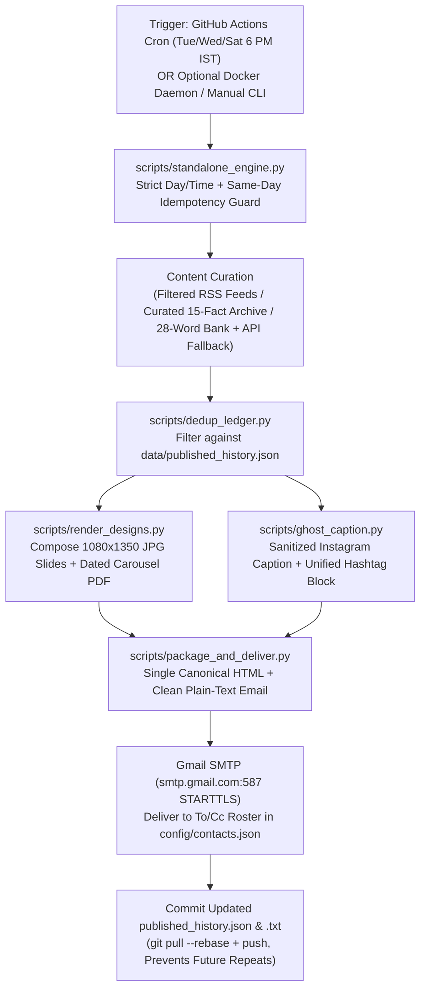

# SOLE — Bits & Bytes Social Media Automation Documentation

Complete technical and operational documentation for the **SOLE (Society Of Literary Enthusiasts) — Bits & Bytes** social media automation system at **IGIT Sarang (Indira Gandhi Institute of Technology, Sarang)**.

---

## 1. Project Overview & Goals

This system automates the weekly research, deduplication, carousel design rendering, Instagram caption drafting, and email packaging for **Bits & Bytes** social media posts on Instagram (`@sole_igit`).

### Core Principles
- **Zero Subscriptions ($0/month):** Runs entirely on free, open-source tooling (Python, Pillow, Docker, GitHub Actions, and Gmail SMTP with an App Password). No paid Zapier, Canva Pro, or third-party SaaS APIs.
- **Standalone & Offline-Capable:** Completely independent of your local laptop. Runs automatically in the cloud via **GitHub Actions** even when your machine is powered off, and optionally runs locally via **Docker Compose**.
- **Human-in-the-Loop Delivery (No Auto-Posting):** The automation never auto-posts to Instagram. Instead, it emails the ready-to-post 1080×1350 carousel designs (dated PDF + JPG slides), Instagram caption, and content brief to the Design & Social Media leads one evening ahead of posting so the team can either publish the generated design directly or adapt it.
- **Instagram-Only:** SOLE does not have a LinkedIn page, so all captions, attachments, and workflows target Instagram (`@sole_igit`) exclusively.

---

## 2. Weekly Schedule (`Asia/Kolkata`)

All scheduled runs execute at **6:00 PM IST (`12:30 UTC`)** the evening before the target Instagram post day:

| Content Type | Mail Day & Time (IST) | Target Post Day | Dated Carousel PDF | Carousel Length | Description |
| :--- | :--- | :--- | :--- | :--- | :--- |
| **Random Fact of the Week** | **Tuesday, 6:00 PM** | Wednesday | `<DateCode>_Random_Fact.pdf` | 4 slides (1080×1350) | Hook cover, the surprising fact, the mechanism/why it happens, and interactive CTA |
| **Random Vocabulary / Thesaurus** | **Wednesday, 6:00 PM** | Thursday | `<DateCode>_Random_Vocabulary.pdf` | 4 slides (1080×1350) | Curiosity hook cover, word + pronunciation + meaning, synonyms/antonyms/usage, and challenge CTA |
| **Weekly News Highlights** | **Saturday, 6:00 PM** | Sunday | `<DateCode>_Weekly_News_Highlights.pdf` | 8 slides (1080×1350) | Cover, all 10 curated highlights across 6 slides (4 dual + 2 spotlight), and interactive poll CTA (plus full Top 10 source table in email) |

---

## 3. System Architecture



### Execution Environments
1. **Offline Cloud Runner (Primary):** [`.github/workflows/bits-bytes-offline-cron.yml`](.github/workflows/bits-bytes-offline-cron.yml) runs on `ubuntu-latest` via a dual-trigger setup:
   - **Exact-time primary trigger (`cron-job.org`):** Dispatches `workflow_dispatch` at **6:00 PM IST (`12:30 UTC`)** on Tue/Wed/Sat so delivery avoids GitHub Actions' native cron queue jitter.
   - **Backup safety-net schedule (GitHub Actions `on.schedule`):** Fires at **6:17 PM IST (`47 12 * * 2`, `47 12 * * 3`, `47 12 * * 6` UTC)**, mapping `github.event.schedule` explicitly to `facts`, `vocab`, or `news`. If `cron-job.org` already delivered at 6:00 PM IST, `already_ran_today()` (18-hour cooldown) skips cleanly with zero duplicates.
   - Protected by a workflow `concurrency` lock, uploads `output/` as a workflow artifact, and commits `data/published_history.json` & `.txt` back to `main` with `git pull --rebase` and `[skip ci]`.
   - Supports manual triggers via `workflow_dispatch` (`auto`, `news`, `facts`, `vocab`, plus `force`, `to_override`, and `no_commit`).
2. **Local Docker Container (Optional):** [`docker-compose.yml`](docker-compose.yml) + [`Dockerfile`](Dockerfile) run a single persistent (`restart: unless-stopped`) `bits-bytes-engine` service (`http://127.0.0.1:8765/health`). Internal cron is disabled by default (`ENABLE_DAEMON_SCHEDULER=false`) to prevent split-brain duplicate sends alongside GitHub Actions. If you disable GitHub Actions and set `ENABLE_DAEMON_SCHEDULER=true`, `daemon_loop` polls every 60 seconds and fires strictly on Tue/Wed/Sat at `>= 18:00 IST`.

---

## 4. Repository Structure

| Path | Purpose |
| :--- | :--- |
| `config/contacts.example.json` | Redacted template for organization metadata, sender info, weekly schedule, and `To` / `Cc` roster. Live `config/contacts.json` is gitignored locally and injected via the `CONTACTS_JSON` secret in GitHub Actions. |
| `assets/bits_n_bytes_template.jpg` | Official SOLE `BITS -N- BYTES` reference poster provided by the team. |
| `assets/sole_logo_hd.png` | High-resolution transparent SOLE logo (270×259 RGBA). |
| `assets/igit_logo_hd.png` | High-resolution transparent IGIT Sarang logo (309×309 RGBA). |
| `assets/base_cover_frame.png` | Pre-baked 1080×1350 cover canvas (cosmic background, exact torn graph-paper corners, HD header logos, footer handle). |
| `assets/base_inner_frame.png` | Pre-baked 1080×1350 inner slide canvas (reused across every slide to minimize compute). |
| `scripts/build_static_assets.py` | One-time / on-demand builder that extracts transparent HD logos and bakes `base_cover_frame.png` & `base_inner_frame.png`. |
| `scripts/standalone_engine.py` | Main entrypoint orchestrating schedule/idempotency guards, curation, deduplication, rendering, captioning, SMTP delivery, and history updates. |
| `scripts/render_designs.py` | Pillow-based 1080×1350 carousel renderer (4:4:4 JPEGs + dated multi-page Carousel PDF + Canva CSV). |
| `scripts/ghost_caption.py` | Instagram-only caption generator & sanitizer (strips em/en dashes, AI buzzwords, raw Markdown, and duplicate hashtag blocks). |
| `scripts/dedup_ledger.py` | Manages `data/published_history.json` and `data/published_history.txt` to prevent duplicate topics. |
| `scripts/package_and_deliver.py` | Single canonical HTML + clean plain-text email builder (`render_content_block_html`, `render_signature_html`, `build_html_email`, `build_plain_text_email`). |
| `data/published_history.json` | Machine-readable deduplication ledger of all previously sent News, Facts, and Vocabulary entries. |
| `data/published_history.txt` | Human-readable mirror of published history. |
| `.github/workflows/bits-bytes-offline-cron.yml` | Zero-cost GitHub Actions cron workflow for offline execution. |
| `Dockerfile` & `docker-compose.yml` | Local containerized runtime (`/app`) for `bits-bytes-engine`. |
| `docs/` | Redacted GitHub sample email (`sample_email.html`, `sample_email.txt`). |

---

## 5. Visual Design System & Pre-Baked Asset Pipeline

The visual design went through multiple iterations and peer review to optimize for short attention spans, mobile readability, and brand fidelity:

### Design Standards (Peer-Approved)
- **Canvas Size:** `1080 × 1350 px` (4:5 Instagram portrait carousel).
- **Exact Brand Edges:** Preserves the exact torn graph-paper corner overlays from the official `BITS -N- BYTES` template (`assets/bits_n_bytes_template.jpg`).
- **100% Horizontally Centered Layout:** All content boxes are centered on `x = 540px` (`COL_X1 = 165`, `COL_X2 = 915`, width `750px`) for clean visual balance.
- **Zero Overlapping or Clipping:** Uses `draw_fitted_text_block()` to dynamically measure, wrap, and scale typography so no text ever overflows its card or collides with adjacent elements.
- **Editorial Rules Enforced:**
  - Always displays a prominent **Week Edition badge** (e.g., `NOV 2026 • WEEK 3`).
  - Uses **`WEEKLY NEWS HIGHLIGHTS`** branding (never `"Top 10 Countdown"`).
  - **No** slide/page number markers (e.g., no `01/08`).
  - **No** relevance/popularity scores or source URLs cluttering the graphic cards (sources are placed cleanly in the email HTML table instead).

### HD Logo Extraction & Static Frame Caching
- **Background Removal Without Interior Loss:** Raw logos were processed via exterior-only BFS flood-fill + anti-aliased edge de-fringing so 100% of interior white details remain intact.
- **Compute Optimization:** Repeated background elements are pre-baked once into `assets/base_cover_frame.png` and `assets/base_inner_frame.png` via `scripts/build_static_assets.py`, reducing per-carousel rendering time to **~1.3s–2.5s**.
- **Cross-Platform Path & Font Portability:** All scripts resolve paths dynamically via `BASE_DIR = Path(__file__).resolve().parent.parent` and discover fonts via `rglob`.
- **Dated Sharp Exports:** Slides are saved as 4:4:4 JPEGs (`quality=92, subsampling=0`) alongside a dated PDF (`<DateCode>_Weekly_News_Highlights.pdf`, `<DateCode>_Random_Fact.pdf`, or `<DateCode>_Random_Vocabulary.pdf`).

---

## 6. Content Curation, Deduplication & Captioning

### Content Quality Controls (`scripts/standalone_engine.py`)
- **News:** Filters junk RSS entries (`Daily Quiz`, `Watch |`, `School Assembly`, `Ask/Show/Launch HN`), strips Hacker News metadata boilerplate, drops empty descriptions, differentiates scores across relevance/popularity signals, and caps each source at max 3/10 slots.
- **Facts:** Uses a curated 15-item verified multi-domain `FACTS_ARCHIVE` (scored `9.3–9.6`) ahead of filtered Wikipedia overflow (`8.5/8.4`, rejecting sports bios/stubs/disambiguations).
- **Vocabulary:** Uses a curated 28-word literary `VOCAB_WORD_BANK` with automatic Datamuse + Free Dictionary API fallback when fewer than 3 unused words remain.

### Deduplication Ledger (`scripts/dedup_ledger.py`)
- Every published News headline, Random Fact, and Vocabulary word is recorded in `data/published_history.json` (and mirrored to `data/published_history.txt`).
- Before rendering, candidate items are checked against the ledger (exact hash, URL, and Jaccard topic similarity) so previously sent topics never repeat.
- `already_ran_today()` checks `email_sent != False` so dry runs never block real scheduled sends, while real sends prevent duplicate emails on the same day.

### Caption Style (`scripts/ghost_caption.py`)
- Generates consistent, conversational Instagram captions for `@sole_igit` exclusively.
- Deterministic by default across cloud and local runs (`ENABLE_LLM_CAPTIONS=false`).
- Mechanically strips em/en dashes (`—`, `–`), banned AI buzzwords, raw Markdown (`**bold**`), and any embedded hashtag blocks before appending one unified, deduplicated hashtag block.

---

## 7. Email Delivery, Anti-Spam Hardening & Recipients

### Anti-Spam & Reliability Engineering (`scripts/package_and_deliver.py` & `scripts/standalone_engine.py`)
Emails are constructed to land cleanly in Gmail's Primary inbox rather than Spam:
- **Full RFC-5322 Headers:** Explicit `Date`, `Message-ID` (domain-qualified), `From`, `To`, `Cc`, and `Reply-To`.
- **Consistent Multipart Structure:** `multipart/mixed` wrapping `multipart/alternative` (clean `text/plain` generated by `build_plain_text_email()` + `multipart/related` containing light `text/html` and inline CID HD logos `igit_logo` & `sole_logo`).
- **Single Canonical Template:** Both single-type emails and `combined-sample` reuse `render_content_block_html()` and `render_signature_html()`.
- **Robust SMTP Transport:** Connects to `smtp.gmail.com:587` (`STARTTLS`) with a **180-second timeout** and **3 automatic retries** with backoff.

### Email Recipients (`config/contacts.json` / `CONTACTS_JSON` Secret)
Personal emails and phone numbers are never committed to the public repository. Copy `config/contacts.example.json` to `config/contacts.json` locally (gitignored) and store the JSON payload in the `CONTACTS_JSON` GitHub Actions repository secret for cloud runs. Automatic deduplication ensures anyone listed in `To` is never duplicated in `Cc`.

- **To — Social Media & Design Team Leads** (`recipients.to.social_media_leads`, `recipients.to.design_leads`)
- **Cc — Bits & Bytes Representatives & Literary Representatives** (`recipients.cc.*`)

---

## 8. Issues Encountered & Resolutions

| Issue | Root Cause | Fix Implemented |
| :--- | :--- | :--- |
| **GitHub Actions `PermissionError: '/home/yashagrawall'`** | Hardcoded local user path in scripts. | Replaced with `BASE_DIR = Path(__file__).resolve().parent.parent` across all scripts and added cross-distro font discovery (`rglob`). |
| **Blurry / Low-Res Logos with White Boxes** | Cropped logos from compressed template image. | Extracted transparent HD PNGs (`sole_logo_hd.png`, `igit_logo_hd.png`) via exterior-only BFS flood-fill + anti-aliased de-fringing. |
| **Gmail SMTP `TimeoutError` (30s)** | Attaching 8 uncompressed PNGs on a 30s timeout. | Switched slides to 4:4:4 JPEGs (`quality=92, subsampling=0`), raised SMTP timeout to 180s with 3 retries. |
| **Mails Firing at Wrong Time / Duplicate Sends** | Docker `daemon_loop` only checked weekday (no 18:00 IST clock check) and ran alongside GitHub Actions; `--type auto` defaulted non-mail days to `news`. | Added exact 18:00 IST time-gating (60s poll), disabled Docker scheduler by default (`ENABLE_DAEMON_SCHEDULER=false`), mapped `github.event.schedule` explicitly, made `--type auto` skip non-mail days, and added same-day idempotency (`already_ran_today()`). |
| **Inconsistent Email Format, Double Hashtags & LinkedIn Leftovers** | Divergent `combined-sample` HTML, non-deterministic local Ollama captions injecting `**bold**` + duplicate hashtags, raw Markdown in `text/plain`, and leftover `linkedin_carousel.pdf` / LinkedIn caption fields. | Unified HTML via `render_content_block_html()` + `render_signature_html()`, added clean `build_plain_text_email()`, purged all SOLE LinkedIn references, named PDFs by content + date, and hardened `ghost_caption.py`. |
| **Random Wikipedia Stubs & Low-Signal RSS News** | Wikipedia random articles scored `9.1/9.0` above unscored `FACTS_ARCHIVE` (`8.0`); RSS heuristic tied items at `9.3/9.2`. | Expanded curated `FACTS_ARCHIVE` (15 items, `9.3–9.6`) and `VOCAB_WORD_BANK` (28 words + API fallback), filtered junk RSS/HN boilerplate, and capped sources at max 3/10 slots. |

---

## 9. Operations & Maintenance Guide

### Required Secrets & Environment Variables
- **Local `.env` + `config/contacts.json`** (both gitignored) & **GitHub Repository Secrets** (`Settings → Secrets and variables → Actions`):
  - `GMAIL_USER` — Sender Gmail address
  - `GMAIL_APP_PASSWORD` — 16-character Google App Password (requires 2-Step Verification enabled on Gmail)
  - `CONTACTS_JSON` — Full JSON content of `config/contacts.json` (used by GitHub Actions so personal emails/phones stay out of the public repo)
  - `ENABLE_DAEMON_SCHEDULER` *(local Docker only, default `false`)* — Set `true` only if disabling GitHub Actions
  - `ENABLE_LLM_CAPTIONS` *(optional, default `false`)* — Set `true` only if you want Ollama/Gemini caption rewriting
  - `GEMINI_API_KEY` *(optional)* — Used only when `ENABLE_LLM_CAPTIONS=true`

### Common CLI Commands

```bash
cd /path/to/bits-bytes-automation

# 1. Dry-run generation locally (no email sent, no history committed)
python3 scripts/standalone_engine.py --type news --no-commit
python3 scripts/standalone_engine.py --type facts --no-commit
python3 scripts/standalone_engine.py --type vocab --no-commit

# 2. Send a single live email for a specific content type
python3 scripts/standalone_engine.py --type news --send-mail

# 3. Force-resend if already emailed today
python3 scripts/standalone_engine.py --type news --send-mail --force

# 4. Send a combined sample (News + Fact + Vocab in 1 email) to a test address only (without burning ledger items)
python3 scripts/standalone_engine.py --type combined-sample --send-mail --no-commit --to-override your_email@gmail.com

# 5. Rebuild pre-baked HD static frames (only needed if logos or base template change)
python3 scripts/build_static_assets.py
```

### Updating Recipients or Code & Deploying Changes
Whenever you edit `config/contacts.json`, `scripts/`, or `assets/`, push to GitHub so GitHub Actions picks up the changes, and rebuild the local Docker engine if running locally:

```bash
cd /path/to/bits-bytes-automation
git add .github/ config/contacts.example.json docker-compose.yml Dockerfile .dockerignore scripts/ docs/ .env.example README.md DOCUMENTATION.md CONTRIBUTING.md data/published_history.json data/published_history.txt
git commit -m "fix: enforce exact scheduling, unify email format, purge LinkedIn & update docs"
git push
docker compose up -d --build bits-bytes-engine
```
